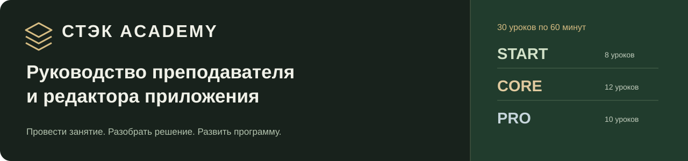
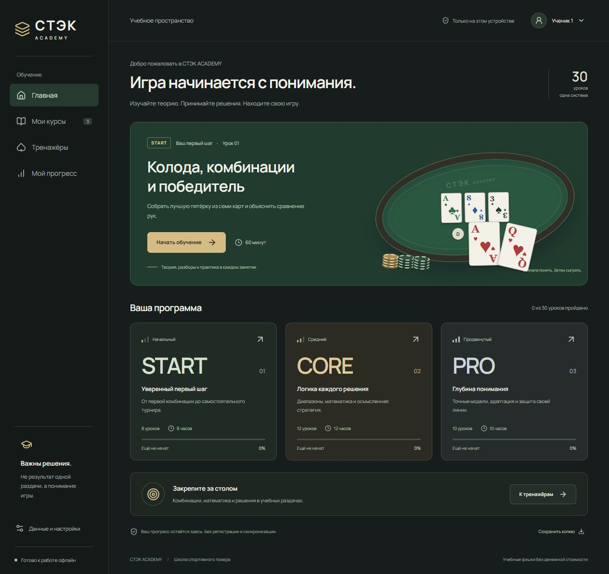
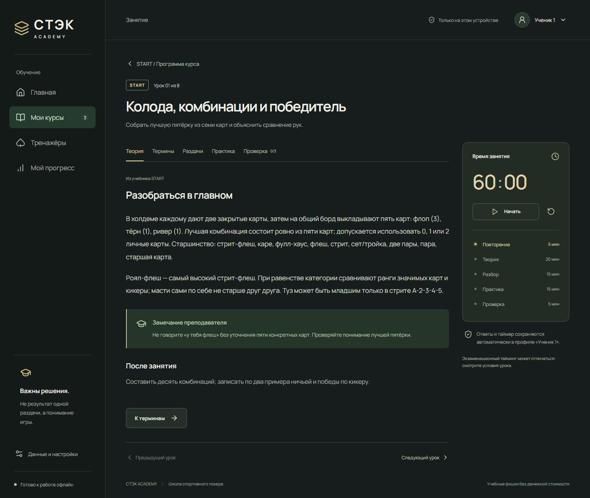
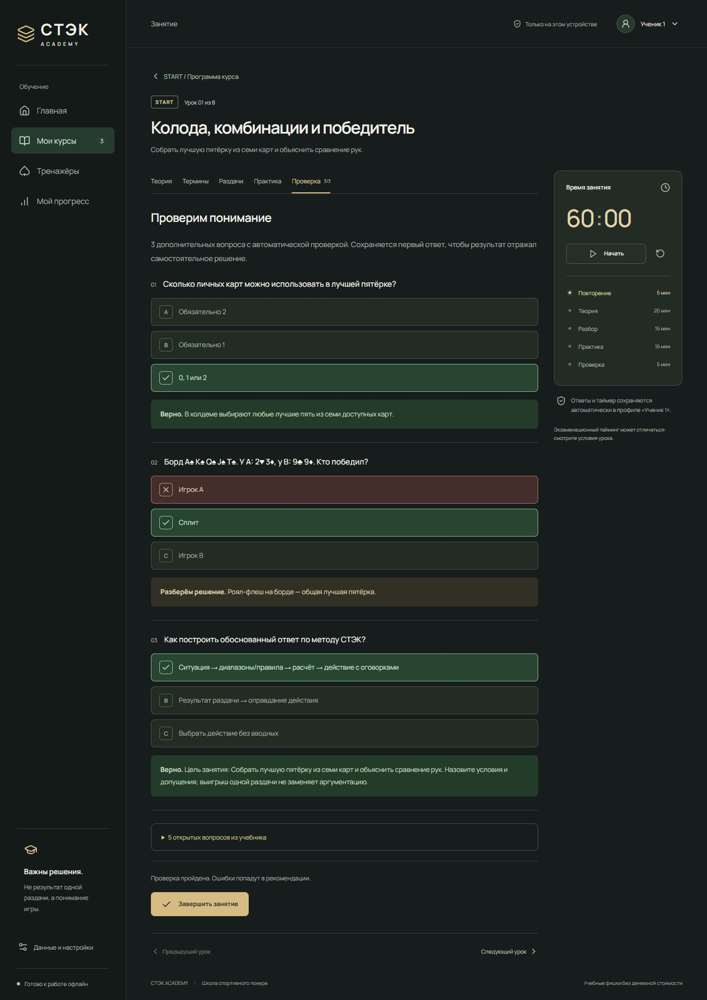
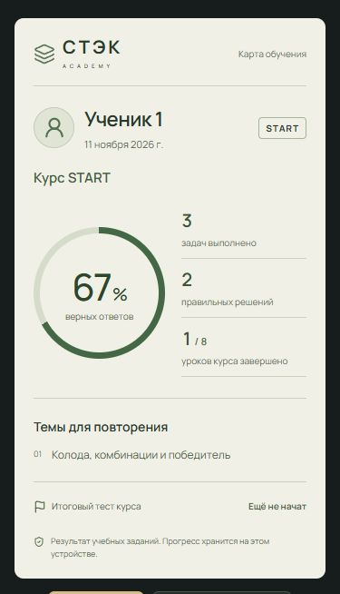
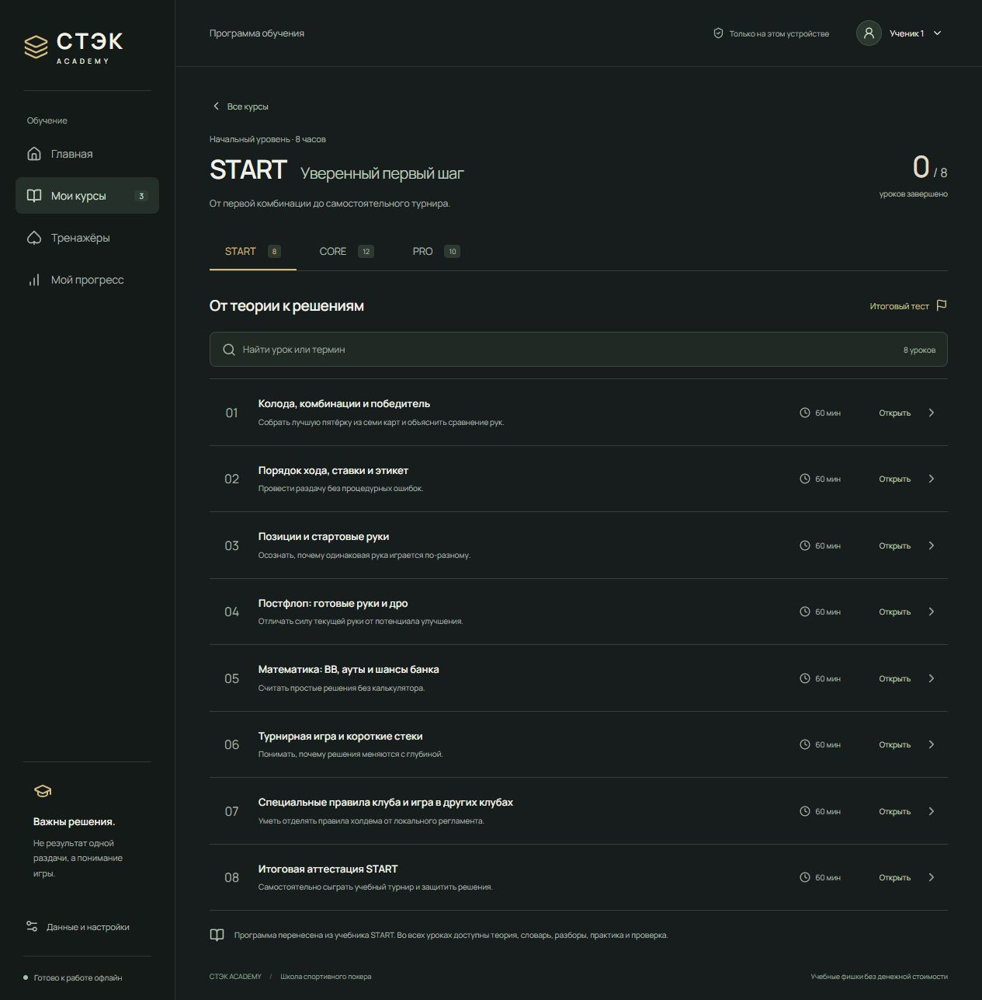
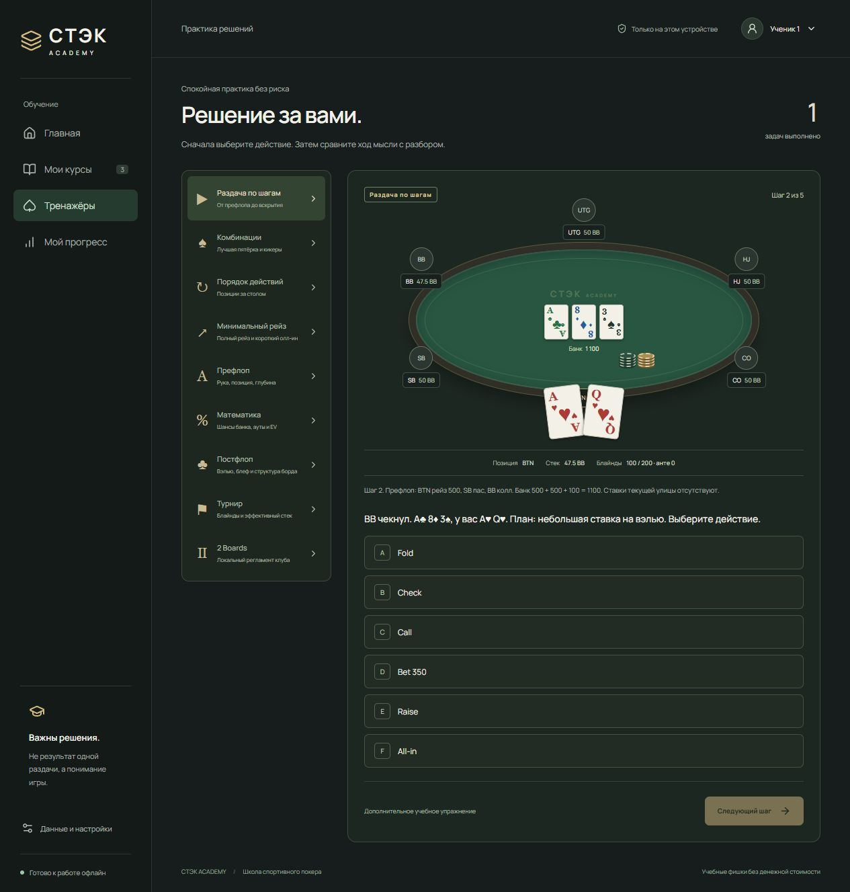

<p align="center">
  <a href="#install">Скачать и запустить</a> ·
  <a href="#classroom">Провести занятие</a> ·
  <a href="#courses">Все 30 уроков</a> ·
  <a href="#edit">Доработать проект</a> ·
  <a href="#help">Решить проблему</a>
</p>

# СТЭК ACADEMY

Учебное приложение для очной школы спортивного покера. Старший крупье открывает урок, объясняет теорию, разбирает ситуации и сохраняет итог занятия. Материалы работают в браузере; результаты остаются на устройстве, где проходило обучение.

**Это руководство для коллеги, который получил проект впервые.** Для проведения занятий читайте разделы 1–7. Для доработки — карту файлов, разделы 8–10 и [пошаговое руководство редактора](docs/DEVELOPMENT.md).

| Программа          | Занятия               | Практика              | Сохранение                                  |
| :----------------- | :-------------------- | :-------------------- | :------------------------------------------ |
| START / CORE / PRO | 30 уроков по 60 минут | 9 разделов тренажёров | Локальные псевдонимы и резервная копия JSON |



> [!IMPORTANT]
> Здесь используются учебные фишки без денежной стоимости. Денежных ставок, платежей, сетевой игры, регистрации и облачного кабинета нет. Выигрыш одной раздачи не служит оценкой качества решения.

<details>
<summary><strong>Полное содержание</strong></summary>

1. [Что входит в приложение](#features)
2. [Как скачать и установить](#install)
3. [Как запускать каждый день](#run)
4. [Как провести занятие](#classroom)
5. [Ученики, отчёты и резервные копии](#progress)
6. [Все 30 уроков](#courses)
7. [Все тренажёры и их допущения](#trainers)
8. [Где что находится в проекте](#files)
9. [Что и как дорабатывать](#edit)
10. [Совместная работа через GitHub](#team)
11. [Все команды](#commands)
12. [Телефон, офлайн и размещение](#offline)
13. [Частые проблемы](#help)
14. [Технологии, проверки и ограничения](#verification)
15. [Что передать второму старшему крупье](#handoff)

</details>

---

<a id="features"></a>

## 1. Что входит в приложение

| Экран               | Что на нём делать                                                    | Где открыть            |
| :------------------ | :------------------------------------------------------------------- | :--------------------- |
| **Главная**         | Выбрать START, CORE или PRO; открыть последний просмотренный урок    | «Главная»              |
| **Программа курса** | Найти тему, увидеть отметки завершения, открыть итоговый тест        | «Мои курсы»            |
| **Урок**            | Читать материал, обсуждать раздачи, выполнять задания и вести таймер | Любой урок в программе |
| **Тренажёры**       | Выбирать решения в учебных ситуациях и читать пояснения              | «Тренажёры»            |
| **Отчёт**           | Посмотреть результат курса/урока, подготовить скриншот или текст     | «Мой прогресс»         |

Внутри: отдельные результаты по псевдонимам, таймер с паузой, 3 автоматических вопроса и 5 исходных открытых вопросов на урок, разборы ответов, экспорт/импорт JSON, мобильная вёрстка, клавиатурное управление и офлайн-копия готовой версии.

Итоговые автоматические тесты содержат **16 вопросов START, 24 CORE и 20 PRO** — по два предметных вопроса из каждого урока. Они дополняют очную аттестацию из учебника.

<a id="install"></a>

## 2. Как скачать и установить

### Шаг 1. Получить доступ

Репозиторий: **[Timoshkins1/stack-academy](https://github.com/Timoshkins1/stack-academy)**.

Он приватный. Владелец приглашает коллегу, а коллега принимает приглашение под своим GitHub-аккаунтом. Если видите `404`, проверьте аккаунт и приглашение: одной ссылки для доступа к приватному проекту недостаточно.

### Шаг 2. Подготовить компьютер

| Что установить                                                                       | Зачем                                                  | Обязательно?                       |
| :----------------------------------------------------------------------------------- | :----------------------------------------------------- | :--------------------------------- |
| [Node.js 24 LTS](https://nodejs.org/en/download)                                     | Запуск инструментов; npm устанавливается вместе с Node | **Да. На Node 24 проект проверен** |
| Современный браузер                                                                  | Отображение приложения и хранение прогресса            | **Да**                             |
| [Visual Studio Code](https://code.visualstudio.com/)                                 | Редактирование файлов и удобный терминал               | Рекомендуется для доработок        |
| [Git](https://git-scm.com/downloads) / [GitHub Desktop](https://desktop.github.com/) | Обновления и обмен изменениями                         | Для совместной разработки          |
| Python                                                                               | Повторное извлечение PDF                               | Нет: материалы уже подготовлены    |

Полный набор команд совместим с Node **22.12+ в ветке 22, 24.x или 26+**. Рекомендуемый для передачи коллеге вариант — 24 LTS. После установки заново откройте терминал и проверьте:

```sh
node --version
npm --version
```

### Шаг 3. Скачать проект одним из способов

<details open>
<summary><strong>ZIP — проще для первого знакомства</strong></summary>

1. Откройте репозиторий под аккаунтом с доступом.
2. Нажмите **Code → Download ZIP**.
3. Распакуйте архив целиком, например в `C:\Projects\stack-academy`.
4. В VS Code выберите **File → Open Folder** и откройте распакованную папку.
5. Выберите **Terminal → New Terminal**.

В папке должен находиться `package.json`. Не запускайте проект внутри ZIP. Такая копия не получает обновления через Git; для доработок вместе удобнее клонирование.

</details>

<details>
<summary><strong>Git — удобнее, если будете дорабатывать вместе</strong></summary>

В терминале из папки, где хотите хранить проект:

```sh
git clone https://github.com/Timoshkins1/stack-academy.git
cd stack-academy
```

При запросе авторизации войдите в свой аккаунт с доступом. Токены и пароли не нужно вставлять в файлы приложения. В GitHub Desktop выберите **File → Clone repository** и найдите `stack-academy`.

Официальная инструкция: [клонирование репозитория](https://docs.github.com/en/repositories/creating-and-managing-repositories/cloning-a-repository).

</details>

### Шаг 4. Установить библиотеки и открыть приложение

В терминале **из папки с `package.json`** выполните по очереди:

```sh
npm install
npm run dev
```

Первая команда скачивает библиотеки; дождитесь её завершения. Интернет нужен при первой установке. Вторая запустит приложение и покажет примерно такой адрес:

```text
Local: http://127.0.0.1:5173/
```

Откройте **адрес из своего терминала**. Если порт занят, Vite может выбрать другой. Терминал с запущенным приложением оставьте открытым.

> [!TIP]
> Если Windows блокирует `npm.ps1`, откройте в VS Code терминал **Command Prompt / Командная строка** или используйте `npm.cmd install` и `npm.cmd run dev`. Менять системную политику безопасности не требуется.

<a id="run"></a>

## 3. Как запускать каждый день

**Для редактирования** откройте ту же папку и выполните:

```sh
npm run dev
```

При сохранении материалов страница обычно обновляется сама. Если после правки кода она стала пустой, перезагрузите её.

**Для занятия и офлайн-проверки** после установки или изменения исходников выполните:

```sh
npm run build
npm run preview
```

Готовая версия обычно открывается на **http://127.0.0.1:4173/**. Дождитесь полной загрузки. На компьютере в боковой панели появится «Готово к работе офлайн».

| Режим     | Для чего                          | Обычный порт | Обновление                                                   |
| :-------- | :-------------------------------- | :----------- | :----------------------------------------------------------- |
| `dev`     | Доработка материалов и интерфейса | 5173         | После сохранения исходника                                   |
| `preview` | Просмотр сборки и проверка офлайн | 4173         | После нового `npm run build` и загрузки обновления браузером |

**Остановить:** нажать `Ctrl+C` в терминале. **Запустить снова:** повторить команду запуска. `npm install` каждый день не нужен — только при первой установке или изменении зависимостей.

> [!IMPORTANT]
> `localhost`, `127.0.0.1`, разные порты и разные браузеры имеют отдельные сохранения. Для постоянных занятий используйте один адрес. Перед его сменой экспортируйте прогресс.

<a id="classroom"></a>

## 4. Как провести занятие

До занятия выберите ученика вверху справа, откройте урок, проверьте разборы и ответы, подготовьте колоду и фишки. Для особых форматов заранее согласуйте письменный регламент клуба.



| Вкладка      | Что внутри                                                | Действие преподавателя                       |
| :----------- | :-------------------------------------------------------- | :------------------------------------------- |
| **Теория**   | Объяснение темы, заметка преподавателя, домашняя работа   | Объяснить идею и допущения                   |
| **Термины**  | Словарь урока                                             | Попросить объяснить термины на примере       |
| **Раздачи**  | Исходный пример и дополнительный разбор                   | Обсудить решение до открытия пояснения       |
| **Практика** | Очное упражнение и 3 дополнительные ситуации              | Дать самостоятельный ответ, разобрать логику |
| **Проверка** | 3 автоматических вопроса и раскрываемые 5 вопросов из PDF | Проверить понимание и обсудить ошибки        |

Таймер запускается вручную кнопкой «Начать», останавливается кнопкой «Пауза» и не переключает вкладки. Запущенный таймер учитывает время вне страницы и после закрытия приложения; на перерыв ставьте паузу. Истечение часа не блокирует ответы.

| Время     | Этап       | Что делать                         |
| :-------- | :--------- | :--------------------------------- |
| 0–5 мин   | Повторение | Вспомнить предыдущую тему          |
| 5–25 мин  | Теория     | Объяснить новую идею               |
| 25–40 мин | Разбор     | Показать и обосновать решение      |
| 40–55 мин | Практика   | Дать самостоятельные задания       |
| 55–60 мин | Проверка   | Разобрать ошибки и домашнюю работу |

На экзаменационных уроках следуйте специальному таймингу в тексте: боковой таймер остаётся стандартным.

Чтобы завершить урок, ответьте на все 3 автоматических вопроса и нажмите **«Завершить занятие»**. Правильность всех трёх не обязательна. Сохранится отметка завершения и откроется отчёт.

Сохраняется **первая попытка** по заданию, включая ошибку. При повторном открытии виден прежний ответ и пояснение. Для новой самостоятельной попытки можно создать отдельный псевдоним. Сброс профиля удаляет весь его прогресс, а не один вопрос.

<details>
<summary>Пример правильного и ошибочного ответа</summary>



</details>

<a id="progress"></a>

## 5. Ученики, отчёты и резервные копии

### Локальные ученики

Нажмите имя вверху справа, выберите псевдоним или добавьте новый, например «Ученик 2». На телефоне кнопка тоже находится сверху. Ответы, отметки уроков и таймеры у каждого отдельные. Допустимо до **50 профилей**, псевдоним — до **32 символов**. Не вводите контакты и другие персональные данные.

### Отчёт после занятия

В «Мой прогресс» выберите курс и режим **«По курсу»** или **«Последний урок»**. Отчёт содержит псевдоним, дату, выполненные задания, верные ответы, процент, завершённые уроки и до трёх тем для повторения.

Процент курса учитывает сохранённые ответы, привязанные к курсу: проверки, практику внутри уроков и итоговый тест. Итоговый тест также показан отдельной строкой. **Свободные тренажёры не входят в процент курса**; их счётчик виден в разделе тренажёров.

«Последний урок» показывает последний просмотренный урок, если он относится к выбранному курсу; иначе — первый урок этого курса. Процент: `верные / выполненные × 100` с округлением до целого; 2 из 3 — это 67%.

<p align="center"></p>
<p align="center"><em>Демонстрационное занятие, не реальные результаты ученика.</em></p>

Для отправки итога: проверьте псевдоним → нажмите **«Экран для скриншота»** → сделайте обычный скриншот → нажмите «Вернуться». Для текста есть **«Скопировать отчёт»**. В мессенджер отправляет преподаватель; автоматической отправки и скачивания PNG в этой версии нет.

### Сохранение и перенос

Откройте **«Данные и настройки»** слева внизу; на телефоне — значок настроек сверху.

| Действие                   | Результат                                                          |
| :------------------------- | :----------------------------------------------------------------- |
| Экспорт прогресса          | JSON со всеми псевдонимами, ответами и таймерами                   |
| Восстановить из файла      | Проверка JSON и подтверждение замены текущих данных                |
| Сбросить активного ученика | После подтверждения удаление результатов только выбранного профиля |

Экспортируйте перед переносом, сменой адреса и очисткой браузера. Храните копию отдельно. Импорт принимает файл до **5 МБ** и **заменяет**, а не объединяет данные. Перед восстановлением чужой копии сохраните свою.

> [!IMPORTANT]
> **Проект и результаты учеников хранятся раздельно.** GitHub содержит программу и материалы. Ответы находятся в браузере, в `localStorage`, ключ `stack-academy-v1`. Скачивание проекта не переносит ответы; `git push` не сохраняет их. Очистка браузера может удалить прогресс и офлайн-копию.

<a id="courses"></a>

## 6. Все 30 уроков

Каждое занятие — **60 минут**. Названия и цели ниже взяты из локальных файлов, перенесённых из учебников. CORE и PRO доступны сразу: последовательность выбирает преподаватель.

### START · 8 уроков · 8 часов

От правил и комбинаций к самостоятельному учебному турниру.

| №   | Тема                                             | Цель занятия                                                   |
| :-- | :----------------------------------------------- | :------------------------------------------------------------- |
| 01  | Колода, комбинации и победитель                  | Собрать лучшую пятёрку из семи карт и объяснить сравнение рук. |
| 02  | Порядок хода, ставки и этикет                    | Провести раздачу без процедурных ошибок.                       |
| 03  | Позиции и стартовые руки                         | Осознать, почему одинаковая рука играется по-разному.          |
| 04  | Постфлоп: готовые руки и дро                     | Отличать силу текущей руки от потенциала улучшения.            |
| 05  | Математика: BB, ауты и шансы банка               | Считать простые решения без калькулятора.                      |
| 06  | Турнирная игра и короткие стеки                  | Понимать, почему решения меняются с глубиной.                  |
| 07  | Специальные правила клуба и игра в других клубах | Уметь отделять правила холдема от локального регламента.       |
| 08  | Итоговая аттестация START                        | Самостоятельно сыграть учебный турнир и защитить решения.      |

[Учебник START](01_START_TEXTBOOK_60_MIN.pdf) · [Файл уроков](src/content/courses/start.json)

### CORE · 12 уроков · 12 часов

Диапазоны, расчёты и планирование действий по улицам.

| №   | Тема                                      | Цель занятия                                                 |
| :-- | :---------------------------------------- | :----------------------------------------------------------- |
| 01  | Диапазоны и комбинаторика                 | Перестать «класть соперника на одну руку».                   |
| 02  | RFI и защита блайндов                     | Строить префлоп-стратегию с учётом позиции.                  |
| 03  | 3-бет, 4-бет и squeeze                    | Понимать мотивы префлоп-агрессии.                            |
| 04  | EV, equity и реализация                   | Отличать математическую возможность от прибыльного действия. |
| 05  | Текстуры бордов и преимущества диапазонов | Определять, кому чаще подходит флоп.                         |
| 06  | Контбеты и сайзинги                       | Выбирать ставку по цели и структуре диапазонов.              |
| 07  | Вэлью, блеф и блокеры                     | Строить понятный диапазон ставок.                            |
| 08  | Тёрн и ривер: план на несколько улиц      | Не играть каждую улицу изолированно.                         |
| 09  | SPR и эффективные стеки                   | Понимать геометрию банка.                                    |
| 10  | Короткие стеки, reshove и анте            | Понимать префлоп при 5–25 BB.                                |
| 11  | Эксплойт, типы соперников и этика         | Менять стратегию на основании наблюдений.                    |
| 12  | Экзамен CORE и разбор раздач              | Защитить последовательную стратегию от префлопа до ривера.   |

[Учебник CORE](02_CORE_TEXTBOOK_60_MIN.pdf) · [Файл уроков](src/content/courses/core.json)

### PRO · 10 уроков · 10 часов

Ограничения моделей, сложные банки и аргументированная защита стратегии.

| №   | Тема                                     | Цель занятия                                                |
| :-- | :--------------------------------------- | :---------------------------------------------------------- |
| 01  | GTO как ориентир, а не догма             | Понимать равновесие и ограничения моделей.                  |
| 02  | Продвинутая префлоп-комбинаторика        | Строить защищённые диапазоны 3-бет/4-бет.                   |
| 03  | Игра в 3-бет и 4-бет-потах               | Планировать ставки при низком SPR.                          |
| 04  | Поляризация, овербеты и геометрия ставок | Управлять давлением на диапазон соперника.                  |
| 05  | MDF и защита ривера                      | Различать теоретическую частоту защиты и практический колл. |
| 06  | ICM и риск-премия                        | Понимать нелинейную ценность турнирных фишек.               |
| 07  | Эксплойт на основе данных                | Строить проверяемые гипотезы об оппонентах.                 |
| 08  | Мультивей, сайд-поты и особые форматы    | Избегать переноса heads-up моделей на сложные банки.        |
| 09  | Разбор раздач и работа с солвером        | Проводить анализ без результата-ориентированного мышления.  |
| 10  | Финальный экзамен PRO и защита модели    | Продемонстрировать зрелую стратегическую аргументацию.      |

[Учебник PRO](03_PRO_TEXTBOOK_60_MIN.pdf) · [Файл уроков](src/content/courses/pro.json)

В материалах сохранены цели, теория, термины, исходный пример, очное упражнение, критерии, домашняя работа, заметки и открытые вопросы. Дополнительные автоматические задания лежат отдельно и помечены в интерфейсе. Автоматический тест не заменяет практическую аттестацию с преподавателем и не выдаёт сертификат.

<details>
<summary>Как выглядит программа курса в приложении</summary>



</details>

<a id="trainers"></a>

## 7. Все тренажёры и их допущения



| Раздел           | Что отрабатывает                                             | Размер подборки                                      |
| :--------------- | :----------------------------------------------------------- | :--------------------------------------------------- |
| Раздача по шагам | Префлоп → флоп → тёрн → ривер → вскрытие одной учебной линии | 5 шагов                                              |
| Комбинации       | Лучшая пятёрка, кикер, общий борд, сплит                     | 3 ситуации                                           |
| Порядок действий | Первый действующий на префлопе/постфлопе, пропуск паса       | 3 ситуации для каждого размера стола; выбор 3–6 мест |
| Минимальный рейз | Полный шаг, короткий олл-ин, повторное открытие торговли     | 3 ситуации                                           |
| Префлоп          | Рука, позиция, открытие, доплата BB                          | 3 ситуации                                           |
| Математика       | Pot odds, EV, ауты, чистый блеф, MDF                         | 6 ситуаций                                           |
| Постфлоп         | Цель вэлью, чек, решение при ставке соперника                | 3 ситуации                                           |
| Турнир           | Рост блайндов, BB, эффективный стек, недостающие вводные     | 3 ситуации                                           |
| 2 Boards         | Неоткрытые улицы, лимит запросов, спорные случаи             | 3 ситуации                                           |

После ответа открывается пояснение и следующий шаг. В конце можно вернуться к началу: это те же задания, первая попытка сохраняется. Перезагрузка начинает показ с первой ситуации, но не удаляет ответы. Новые уникальные раздачи бесконечно не генерируются.

Карты: `A` — туз, `K` — король, `Q` — дама, `J` — валет, `T` — десятка. Масти обозначены цветом и значком ♠ ♥ ♦ ♣; сама масть старшинства не даёт.

### Какие допущения проговаривать

- **Pot odds:** `P` — банк до ставки; при ставке и колле по `B` порог равен `B / (P + 2B)`.
- **EV колла:** `equity × итоговый банк − цена колла`; в этой учебной модели будущих ставок нет.
- **Ауты:** предполагаются чистыми. Шанс увидеть обе карты не сравнивают с ценой одной улицы, если за следующую нужно платить отдельно.
- **Блеф и MDF:** упрощённая риверная модель чистого блефа без equity; частота диапазона не предписывает колл любой конкретной руки.
- **Префлоп и постфлоп:** ответ соответствует условиям задачи; другие диапазоны, позиции и стеки могут изменить решение.
- **ICM:** есть теория и вопросы об условиях применения; автоматического решателя нет.

### Локальный формат «2 Boards»

Запрашивает инициатор олл-ина, согласие соперника не требуется, максимум два использования на игрока. Дважды открываются только нераскрытые улицы: при олл-ине на тёрне — только ривер. **Мультивей, нечётные фишки и несколько запросов — уточнить регламент клуба.** Это не универсальные правила холдема. Общие процедурные примеры сверены с [Poker TDA](https://www.pokertda.com/view-poker-tda-rules/).

<a id="files"></a>

## 8. Где что находится в проекте

```text
stack-academy/
├── README.md                    ← это руководство
├── docs/DEVELOPMENT.md           ← рецепты доработки
├── docs/images/                 ← обложка и скриншоты
├── 01_START_TEXTBOOK_60_MIN.pdf  ← первоисточник START
├── 02_CORE_TEXTBOOK_60_MIN.pdf   ← первоисточник CORE
├── 03_PRO_TEXTBOOK_60_MIN.pdf    ← первоисточник PRO
├── 04_PROMPT_LIGHT_APP.txt      ← требования к приложению
├── 05_PROMPT_LIGHT_APP.pdf      ← требования в PDF
├── src/
│   ├── App.tsx                  ← пять экранов, навигация, диалоги
│   ├── main.tsx                 ← вход, шрифты, подключение стилей
│   ├── styles.css               ← основная визуальная система
│   ├── mobile.css               ← мобильная версия и режим скриншота
│   ├── components/
│   │   ├── Table.tsx            ← стол, карты, фишки, позиции
│   │   └── QuestionCard.tsx     ← ответы и пояснения
│   ├── content/
│   │   ├── courses/             ← start.json, core.json, pro.json
│   │   ├── index.ts             ← каталог курсов и подключение уроков
│   │   ├── quiz.ts              ← автоматические вопросы уроков
│   │   ├── exercises.ts         ← ситуации и привязка к урокам
│   │   └── content.test.ts      ← проверка целостности материалов
│   └── lib/
│       ├── poker.ts             ← математика и оценка комбинаций
│       ├── poker.test.ts        ← проверки покерной логики
│       ├── storage.ts           ← прогресс, таймер, экспорт, импорт
│       └── storage.test.ts      ← проверки сохранений
├── public/                      ← иконки приложения SVG/PNG
├── scripts/                     ← извлечение PDF и создание иконок
├── .agents/skills/              ← инструкции ИИ-помощнику разработчика
├── package.json                 ← библиотеки и команды
├── package-lock.json            ← закреплённые версии библиотек
├── vite.config.ts               ← сборка, PWA, кеш
├── tsconfig.json                ← проверка TypeScript
├── .npmrc                       ← локальная папка кеша npm
├── .gitignore                   ← исключения для GitHub
├── DESIGN.md                    ← принципы оформления
├── VERIFICATION.md              ← протокол проверок
├── output/                      ← общий скриншот приложения
├── node_modules/                ← появится после установки; не редактировать
├── dist/                        ← появится после сборки; не редактировать
└── .tools/                      ← локальный кеш; не отправляется в GitHub
```

`README.txt` — исходная короткая записка из комплекта. Рабочая инструкция — этот файл. `tsconfig.tsbuildinfo`, если появился, — автоматически созданный кеш.

**Самая частая работа:** текст → `courses/*.json`; вопросы → `quiz.ts`; тренажёры → `exercises.ts`; внешний вид → `styles.css` и `mobile.css`.

<a id="edit"></a>

## 9. Что и как дорабатывать

| Задача                              | Где менять                                                    | Что проверить                              |
| :---------------------------------- | :------------------------------------------------------------ | :----------------------------------------- |
| Объяснение, термин, домашняя работа | Нужный JSON курса                                             | Текст и вкладки урока                      |
| Вопрос, правильный ответ, пояснение | `src/content/quiz.ts`                                         | Варианты и новый тестовый псевдоним        |
| Учебная ситуация                    | `src/content/exercises.ts`                                    | Карты, банк, стеки, ответ и длина подборки |
| Новый урок                          | JSON, каталог, вопросы, привязка тренажёра и счётчики         | Уникальный ID, тесты и длительность        |
| Локальный регламент                 | Материалы START, `exercises.ts`, при необходимости `poker.ts` | Согласование клуба и единые формулировки   |
| Цвета, размеры, телефон             | `styles.css`, `mobile.css`                                    | Ширина 375 px, контраст, кнопки            |
| Отчёт и экраны                      | Функции в `src/App.tsx`                                       | Псевдоним, состав статистики и скриншот    |
| Расчёты                             | `src/lib/poker.ts`                                            | Предметный тест с ручным расчётом          |
| Формат прогресса                    | `src/lib/storage.ts`                                          | Версия данных и миграция старых копий      |
| Название и иконка PWA               | `vite.config.ts`, `public/`, `index.html`                     | Новая сборка и установленная копия         |

Для первой доработки исправьте одно знакомое объяснение и проверьте его в браузере. Схема урока, примеры вопросов, карт и ситуаций приведены в [руководстве редактора](docs/DEVELOPMENT.md).

**Сохраняйте стабильные ID.** Переименование заголовка не требует нового ID урока. Если меняется смысл вопроса или порядок вариантов, старые ответы автоматически не пересчитываются: нужна стратегия новой версии задания/миграции. Не правьте `dist` вручную — она пересоздаётся сборкой.

<a id="team"></a>

## 10. Совместная работа через GitHub

Одна ветка — одна понятная задача. Например, уточнение терминов:

```sh
git switch main
git pull --ff-only
git switch -c docs/clarify-start-terms
```

Внесите правки, затем проверьте:

```sh
npm test
npm run build
git diff
```

Отправьте только нужные файлы, например:

```sh
git add src/content/courses/start.json
git commit -m "Уточнить термины START"
git push -u origin docs/clarify-start-terms
```

На GitHub выберите **Compare & pull request**, напишите, что изменено, зачем и что проверено. Второй преподаватель посмотрит разницу перед объединением с `main`.

Перед новой работой выполняйте `git pull --ff-only`. Если Git сообщает о локальных правках или конфликте, сначала разберите их; не сбрасывайте изменения с удалением. В GitHub Desktop доступны те же операции через кнопки веток, Fetch/Pull, Commit, Push и Create Pull Request.

Копии результатов реальных учеников передавайте отдельно, не через коммит. `node_modules`, `dist`, временные файлы и кеш уже исключены через `.gitignore`.

<a id="commands"></a>

## 11. Все команды

Выполняются в корне проекта, рядом с `package.json`.

| Команда                | Назначение                                                    |
| :--------------------- | :------------------------------------------------------------ |
| `npm install`          | Установка библиотек; может изменить lock-файл                 |
| `npm ci`               | Установка строго по lock-файлу с пересозданием `node_modules` |
| `npm run dev`          | Запуск версии для редактирования                              |
| `npm test`             | Однократный запуск проверок математики, контента и хранения   |
| `npm run build`        | Проверка TypeScript, создание `dist`, манифеста и офлайн-кеша |
| `npm run preview`      | Просмотр уже собранной папки `dist`                           |
| `npm run format`       | Форматирование исходников и корневых документов; меняет файлы |
| `npm audit --omit=dev` | Проверка известных проблем библиотек рабочего приложения      |
| `git status`           | Текущая ветка и изменённые файлы                              |
| `git diff`             | Разница перед сохранением изменений                           |

Нет команд `npm start`, `lint`, отдельного backend и обязательного `.env`. Для запуска не нужны платные API, OpenAI, Supabase, подписки или ИИ-помощник.

<a id="offline"></a>

## 12. Телефон, офлайн и размещение

PWA — приложение, которое браузер может сохранить для самостоятельного открытия. Код, материалы, иконки и шрифты поставляются вместе. Офлайн работает у **собранной версии**, после первой полной загрузки, а не у `dev`.

**На компьютере:** собрать, открыть `preview`, дождаться загрузки. Ранее проверено открытие всех уроков после остановки сервера. Браузер может удалить кеш при очистке или нехватке места — перед важным занятием проверьте доступ без сети.

**На телефоне:** сначала нужен доступный устройству **HTTPS-адрес размещённой сборки**. Затем используйте меню «Установить приложение» / «На экран Домой». `127.0.0.1` на телефоне означает сам телефон, не компьютер преподавателя. Локальная ссылка не является опубликованным сайтом.

**Для размещения:** на статический HTTPS-хостинг отправляют содержимое `dist`: `index.html`, `assets`, `sw.js`, манифест и иконки. Сам `git push` сохраняет исходники и не публикует сайт. Для адреса с подпапкой нужно отдельно согласовать `base` Vite и PWA. [Подробности размещения и обновлений](docs/DEVELOPMENT.md#hosting).

<a id="help"></a>

## 13. Частые проблемы

| Что видно                              | Что делать                                                                                                                                     |
| :------------------------------------- | :--------------------------------------------------------------------------------------------------------------------------------------------- |
| GitHub `404`                           | Войти в нужный аккаунт и принять приглашение                                                                                                   |
| `node` / `npm` не найдены              | Установить Node 24 LTS, заново открыть терминал                                                                                                |
| Заблокирован `npm.ps1`                 | Command Prompt или `npm.cmd`; системную защиту отключать не нужно                                                                              |
| `ENOENT`, нет `package.json`           | Перейти в распакованную папку проекта                                                                                                          |
| Страница не открывается                | Проверить работающий терминал и точный напечатанный адрес                                                                                      |
| Порт занят                             | Открыть предложенный Vite адрес либо остановить свою прежнюю копию через `Ctrl+C`. На другом порту другое сохранение                           |
| `preview` не находит `dist`            | Сначала `npm run build`                                                                                                                        |
| Ошибка после правки JSON               | Проверить двойные кавычки, скобки и запятые. В JSON нет комментариев и завершающей запятой                                                     |
| Новое видно в `dev`, но не в `preview` | Пересобрать. Сохранить прогресс, закрыть все вкладки/установленные окна этого приложения и открыть снова; при необходимости повторить открытие |
| Пропали результаты                     | Проверить псевдоним, браузер, адрес и порт. При очистке данных восстановить JSON                                                               |
| JSON не скачивается                    | Проверить блокировку загрузки браузером; разрешение принимает пользователь, обходить запрет не нужно                                           |
| Импорт не принят                       | Нужна копия СТЭК ACADEMY до 5 МБ, не произвольный JSON или PDF                                                                                 |
| «Завершить занятие» неактивно          | Ответить на все 3 вопроса во вкладке «Проверка»                                                                                                |
| Ответ нельзя выбрать заново            | Сохранена первая попытка; для новой создать отдельный псевдоним                                                                                |
| Таймер уменьшился после закрытия       | Он был запущен; на перерыв нажимать «Пауза»                                                                                                    |
| Телефон не открывает `127.0.0.1`       | Нужен доступный телефону адрес; для установки PWA — HTTPS                                                                                      |
| Отчёт не копируется                    | При ограничении буфера обмена выделить текст вручную или сделать скриншот                                                                      |

<a id="verification"></a>

## 14. Технологии, проверки и ограничения

На 11 ноября 2026 года сборка прошла успешно, **60 тестов в 3 файлах** — без ошибок. В браузере проверены все 30 уроков, восстановление ответов/таймера, отдельные профили, пошаговая раздача, ширина 375 px, отчёт и офлайн-кеш. Подробности — [VERIFICATION.md](VERIFICATION.md).

Реальные Android/iOS-устройства и системная установка PWA отдельно не проверялись. Полный браузерный цикл экспорт → импорт не подтверждён: скачивание было остановлено отказом разрешения браузера. Валидатор JSON и разделение профилей покрыты тестами. Иллюстрации руководства сняты в отдельной демонстрационной копии.

| Инструмент                | За что отвечает                    |
| :------------------------ | :--------------------------------- |
| React + TypeScript        | Экраны, состояние и проверка типов |
| Vite                      | Разработка и сборка                |
| vite-plugin-pwa / Workbox | Манифест и офлайн-кеш              |
| localStorage              | Прогресс в браузере                |
| Vitest                    | Автоматические проверки            |
| Manrope / Fontsource      | Локальный шрифт с кириллицей       |
| Lucide                    | Иконки                             |
| Prettier                  | Форматирование                     |

Точные версии находятся в [package-lock.json](package-lock.json). Оформление — собственный CSS; Tailwind и тяжёлого UI-кита нет. Оценка комбинаций написана в проекте. Принципы стиля — [DESIGN.md](DESIGN.md).

В `.agents/skills/` сохранены [Anthropic frontend-design](.agents/skills/frontend-design/SKILL.md) и [Vercel web-design-guidelines](.agents/skills/web-design-guidelines/SKILL.md). Они помогают разработчику/ИИ-помощнику и не нужны для обычного запуска.

React, Vite и Lucide используют MIT, Manrope — SIL OFL 1.1; лицензия навыка Anthropic лежит рядом с ним. Общая лицензия на код и учебники всего проекта пока не задана. Приватный доступ для совместной работы не означает разрешения на открытое распространение учебников.

На предыдущей проверке `npm audit --omit=dev` не нашёл проблем рабочего приложения. В инструменте сборки оставалась транзитивная проблема низкого уровня `deepmerge`, отражённая в четырёх связанных записях. Это состояние на дату проверки. Не выполняйте `npm audit fix --force` без разбора изменений.

**Границы версии:** нет сетевой игры, бесконечного генератора раздач, GTO/ICM-решателя, облачного журнала, синхронизации, автоматической сертификации и отправки ученикам. Преподаватель оценивает аргументацию, а приложение поддерживает очную работу.

<a id="handoff"></a>

## 15. Что передать второму старшему крупье

- [ ] Приглашение в репозиторий и ссылку на это руководство.
- [ ] Актуальную ветку: основная — `main`.
- [ ] Рекомендуемую версию Node: 24 LTS.
- [ ] Исходные учебники: находятся в корне проекта.
- [ ] Письменный локальный регламент, особенно спорные случаи «2 Boards».
- [ ] Первую задачу для доработки и критерий её проверки.
- [ ] При переносе занятий — отдельную JSON-копию прогресса подходящим способом, не коммитом.
- [ ] Порядок работы: ветка → правка → тесты/сборка → pull request → просмотр коллегой.

**Провести первое занятие:** [установка](#install) → [запуск](#run) → [работа с уроком](#classroom).

**Сделать первую доработку:** [карта файлов](#files) → [руководство редактора](docs/DEVELOPMENT.md) → [совместная работа](#team).
