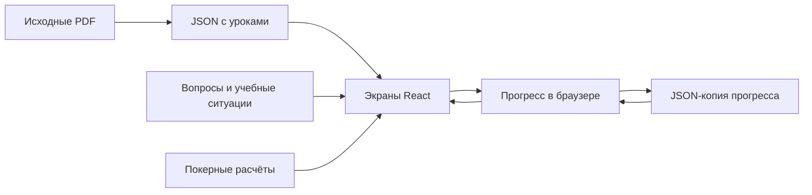

# Как дорабатывать СТЭК ACADEMY

[← Вернуться к основному руководству](../README.md)

Это инструкция для второго старшего крупье и разработчика. Начните с небольшой правки знакомого урока. Программа, интерфейс и результаты учеников связаны через идентификаторы: изменение текста обычно безопаснее изменения ID и формата сохранений.

**Маршрут:** [урок](#lesson) · [вопросы](#quiz) · [ситуации](#exercise) · [новый урок](#new-lesson) · [экраны](#screens) · [данные](#data) · [проверки](#checks) · [размещение](#hosting).

## Как устроен поток данных



GitHub хранит исходники, а не узел «Прогресс в браузере». PDF не читаются приложением при каждом запуске: оно использует уже подготовленные JSON.

<a id="lesson"></a>

## 1. Исправить текст урока

**Пример задачи:** понятнее объяснить pot odds в START, урок 05.

1. Откройте [../src/content/courses/start.json](../src/content/courses/start.json).
2. Найдите объект с `"id": "start-05"`.
3. Измените нужное текстовое поле. Для этого не нужно редактировать React.
4. Сохраните файл, выполните `npm run dev` из корня проекта.
5. Откройте START → урок 05 и проверьте соответствующую вкладку.
6. Выполните `npm test` и `npm run build`.

### Все поля урока

| Поле        | Что означает                                    | Где используется                                        |
| :---------- | :---------------------------------------------- | :------------------------------------------------------ |
| `id`        | Стабильный код, например `start-05`             | Навигация, прогресс, вопросы и привязки                 |
| `number`    | Порядковый номер внутри курса, начиная с 1      | Список и переходы между уроками                         |
| `title`     | Название темы                                   | Заголовок, поиск, отчёт                                 |
| `duration`  | Продолжительность, сейчас 60                    | Контент и проверки; сам таймер настроен отдельно        |
| `source`    | Имя исходного PDF                               | Происхождение материала                                 |
| `goal`      | Цель занятия                                    | Подзаголовок и объяснение общего контрольного вопроса   |
| `timing`    | Исходный тайминг текстом                        | Сохранённые данные; не управляет автоматически таймером |
| `theory`    | Основная теория                                 | «Теория» и поиск по теме                                |
| `terms`     | Термины строкой                                 | «Термины» и поиск                                       |
| `hand`      | Исходный учебный пример с разбором              | «Раздачи»                                               |
| `practice`  | Очное практическое упражнение                   | «Практика»                                              |
| `answer`    | Ответ и критерии из учебника                    | Обсуждение исходного разбора                            |
| `homework`  | Домашнее задание                                | «Теория»                                                |
| `notes`     | Заметка старшего крупье                         | Выделенный блок в теории                                |
| `questions` | Пять исходных открытых вопросов и шаблон ответа | Раскрываемый блок «Проверки»                            |

Для словаря используется форма **«Термин — определение.»**. Компонент разделяет записи по предложениям; слишком сложное форматирование и сокращения с точками нужно проверять в браузере. Тексты выводятся как текст, HTML-разметка в JSON не превращается в оформление страницы.

### Правила JSON

- Файл курса — массив объектов: внешние скобки `[...]`, отдельный урок — `{...}`.
- Ключи и строки заключены в двойные кавычки.
- Между объектами и полями нужна запятая; после последнего элемента — нет.
- Комментарии `//` внутри JSON недопустимы.
- Кавычку внутри строки записывают как `\"`, обратную косую черту — как `\\`.
- Сохраняйте файл в UTF-8; для русских кавычек удобно использовать «ёлочки».

**Не переименовывайте `id` ради красивого заголовка.** Для исправления названия достаточно `title`. Если сознательно отступаете от текста PDF, отметьте в материале, что это дополнение/редакция, и сохраняйте первоисточник.

### Повторное извлечение PDF — только при необходимости

Обычное изменение уроков не требует Python. Если нужно воспроизвести перенос из исходных учебников, из корня проекта:

```sh
python -m pip install --target .tools/python pypdf
python -X utf8 scripts/extract-content.py
```

> [!WARNING]
> Этот скрипт **перезаписывает все три JSON курса**. Сначала сохраните ручные доработки в Git и просмотрите последующую разницу. Скрипт рассчитан на структуру приложенных PDF; для другого макета его может потребоваться изменить. Числа и формулы после извлечения проверяет преподаватель.

<a id="quiz"></a>

## 2. Изменить автоматический вопрос

Файл: [quiz.ts](../src/content/quiz.ts). В объекте `rows` каждому ID урока соответствует **10 строк**: два предметных вопроса по пять строк.

| Позиция | Содержание                |
| :------ | :------------------------ |
| 1       | Текст первого вопроса     |
| 2       | Его правильный вариант    |
| 3–4     | Два неправильных варианта |
| 5       | Пояснение первого ответа  |
| 6       | Текст второго вопроса     |
| 7       | Его правильный вариант    |
| 8–9     | Два неправильных варианта |
| 10      | Пояснение второго ответа  |

Пример записи **внутри `rows`** для START 05:

```ts
"start-05": [
  "Банк 1000 до ставки, ставка и колл по 500. Порог equity?",
  "25%",
  "33,3%",
  "50%",
  "500 / (1000 + 500 + 500) = 25% без будущих ставок.",
  "Стек 30 000, BB 1000. Сколько больших блайндов?",
  "30 BB",
  "15 BB",
  "300 BB",
  "30 000 / 1000 = 30 больших блайндов.",
],
```

Функция `questionsFor()` сама добавляет третий общий вопрос о методе СТЭК и переставляет варианты, чтобы верный не находился всегда первым. **В исходной записи правильный ответ всё равно ставится первым.** Не меняйте `correct` вручную ради перестановки в интерфейсе.

Эти же первые два вопроса используются в итоговом тесте курса, а также в первых двух дополнительных ситуациях урока. Третья ситуация урока берётся из привязанного раздела тренажёров. Таким образом, правка `quiz.ts` влияет сразу на несколько мест — проверьте каждое.

Сохранённые ответы используют ID вида `start-05-q1`. Изменение смысла или порядка вариантов при прежнем ID может сделать старый ответ несопоставимым с новым заданием. Для существенного обновления заранее решите, как версионировать вопросы и переносить данные. Для ручной проверки создайте новый тестовый псевдоним.

<a id="exercise"></a>

## 3. Изменить или добавить учебную ситуацию

Файл: [exercises.ts](../src/content/exercises.ts).

| Часть файла                             | За что отвечает                                                     |
| :-------------------------------------- | :------------------------------------------------------------------ |
| `categories`                            | Названия и описания девяти разделов                                 |
| `Exercise`                              | Поля одной ситуации                                                 |
| `base`                                  | Общие значения, которые задача наследует, если их не переопределить |
| `q(...)`                                | Сборка вопроса вместе с параметрами стола                           |
| `exerciseFor(category, index, players)` | Выбор ситуации по разделу и номеру                                  |
| `categoryForLesson(id)`                 | Какой раздел связан с конкретным уроком                             |

### Все поля ситуации

| Поле            | Значение                                                         |
| :-------------- | :--------------------------------------------------------------- |
| `id`            | Код задания; результат привязан к нему                           |
| `prompt`        | Вопрос ученику                                                   |
| `options`       | Варианты ответа                                                  |
| `correct`       | Индекс верного варианта: отсчёт **с нуля**                       |
| `explanation`   | Обоснование и условия применимости                               |
| `topic`         | Тема для результата                                              |
| `board`         | Массив открытых общих карт; `[]` на префлопе                     |
| `hero`          | Личные карты ученика                                             |
| `villain`       | Показанные карты соперника; `[]`, если скрыты                    |
| `players`       | Число мест: 3–6                                                  |
| `position`      | Позиция ученика, например `BTN`                                  |
| `stack`         | Оставшийся стек ученика **в BB**                                 |
| `opponentStack` | Необязательный стек BB-соперника в BB                            |
| `pot`           | Банк **в фишках**, не в BB                                       |
| `blinds`        | Строка с блайндами и анте                                        |
| `context`       | Предыдущие действия и допущения                                  |
| `actions`       | `true` сохраняет порядок кнопок Fold/Check/Call/Bet/Raise/All-in |

Пример вызова `q(...)` внутри функции выбора ситуации:

```ts
q(
  "",
  "В банке 1000 до ставки. Соперник поставил 500. Порог equity?",
  ["25%", "33,3%", "50%"],
  0,
  "500 / 2000 = 25% при отсутствии будущих ставок.",
  {
    board: ["Ac", "8d", "3s"],
    hero: ["Ah", "Qh"],
    villain: [],
    players: 6,
    position: "BTN",
    stack: 50,
    pot: 1500,
    blinds: "100 / 200 · анте 0",
    context:
      "Дополнительное упражнение. Банк на столе уже включает ставку 500.",
  },
);
```

Это образец формата, не готовая команда для терминала. Число `1500` в `pot` здесь намеренно включает ставку соперника, а `1000` в условии — банк **до** этой ставки. Следите, чтобы стол, вопрос и формула говорили об одном и том же моменте раздачи.

### Кодировка карт в исходниках

| Часть | Допустимые значения                | Пример                                |
| :---- | :--------------------------------- | :------------------------------------ |
| Ранг  | `2`–`9`, `T`, `J`, `Q`, `K`, `A`   | Десятка записывается `T`, не `10`     |
| Масть | `s` = ♠, `h` = ♥, `d` = ♦, `c` = ♣ | `As` — туз пик, `Th` — десятка червей |

Одна карта — ровно две латинские буквы/символа. В борде и руках одной ситуации не должно быть дубликатов. При сравнении нужен борд из пяти карт и по две карты у двух игроков. Картинки отрисовываются в [Table.tsx](../src/components/Table.tsx); менять их вручную для каждой задачи не нужно.

### Если добавляете новый пример, а не заменяете старый

Сейчас длины подборок заданы и в `exercises.ts`, и в функции **`Trainer` в `App.tsx`**. Математика использует 6 ситуаций, сквозная раздача — 5, остальные — 3. Нужно согласованно изменить:

1. Выбор/циклический индекс ситуации в `exerciseFor`.
2. Общее число рядом с «Ситуация … из …» в `Trainer`.
3. Предел перехода «Следующая ситуация» и условие «К началу подборки».
4. Правила ID: вставка в середину не должна незаметно присвоить старый результат другой задаче.
5. Тесты целостности карт и сам новый кейс.
6. Размер подборки в README.

Добавление задания только в массив не гарантирует, что до него можно дойти кнопкой. Если расширение станет регулярным, сначала разумно вынести размеры подборок в одно место.

<a id="new-lesson"></a>

## 4. Добавить новый урок или курс

### Урок в существующем курсе

1. Добавьте полный объект в соответствующий JSON-массив. Существующие ID сохраните; новому назначьте уникальный, например `start-09`.
2. Соблюдайте порядок `number`: 1, 2, … без пропусков. Переходы «Предыдущий/следующий» сейчас опираются на этот порядок.
3. Заполните все поля из раздела 1. Добавленный авторский материал честно обозначьте как дополнение.
4. Добавьте две предметные проверки в `rows` файла `quiz.ts`.
5. Добавьте привязку `categoryForLesson` в `exercises.ts`.
6. В [content/index.ts](../src/content/index.ts) проверьте описание и число часов курса.
7. В `App.tsx` найдите жёстко заданные общие **30 уроков** и счётчик **3 курсов**, если изменяется программа; обновите соответствующие надписи.
8. В [content.test.ts](../src/content/content.test.ts) обновите ожидаемые `[8, 12, 10]` и общее количество. Прочие проверки не удаляйте.
9. Обновите список тем, часы и количество вопросов итогового теста в README.
10. Проверьте урок в браузере, итоговый тест, отчёт, сохранение и сборку.

Изменение только `duration` не меняет реальный таймер: сейчас 3600 секунд и этапы 5/20/15/15/5 находятся в `App.tsx`, а предел таймера также проверяется в `storage.ts`. В рамках текущей программы сохраняйте 60 минут.

### Совсем новый курс

Дополнительно потребуются импорт нового JSON и запись в каталоге `courses`, вопросы, визуальное представление, обновление счётчиков, тестов и **валидатора сохранений**. Сейчас `storage.ts` допускает в завершённых уроках коды только `start/core/pro` с двухзначным номером. Без изменения этого правила новый курс может не восстановиться из JSON-копии. Продумайте совместимость прежних резервных копий.

<a id="screens"></a>

## 5. Где менять экраны и оформление

Все пять страниц сейчас находятся в [App.tsx](../src/App.tsx), а повторяемые элементы — в `components/`.

| Функция          | Ответственность                                      |
| :--------------- | :--------------------------------------------------- |
| `App`            | Общее состояние, оболочка, сохранение, маршруты      |
| `Home`           | Главная, курсы, переход к последнему уроку           |
| `Course`         | Поиск, список уроков, итоговый автоматический тест   |
| `LessonPage`     | Вкладки, таймер, дополнительные ситуации, завершение |
| `Trainer`        | Выбор раздела/мест, текущая ситуация, переходы       |
| `Report`         | Фильтр курса/урока, статистика, текст и скриншот     |
| `Modal`          | Базовый диалог                                       |
| `ProfileDialog`  | Добавление и переключение псевдонимов                |
| `SettingsDialog` | Экспорт, импорт и сброс                              |

Маршруты используют часть адреса после `#`: `#home`, `#course/start`, `#lesson/start-01`, `#trainer/math`, `#report`. Новые маршруты нужно добавить в тип `Route`, `parseRoute` и ветвление экрана, а не только в кнопку.

Основная палитра — CSS-переменные в начале [styles.css](../src/styles.css): `--bg`, `--panel`, `--line`, `--muted`, `--gold`, `--green`, `--text`. [mobile.css](../src/mobile.css) подключён после основного файла и уточняет мобильные размеры. Если изменение «не сработало», проверьте последующее мобильное переопределение. Правило `body.report-capture` скрывает оболочку в режиме скриншота.

Сохраняйте видимый клавиатурный фокус, размеры кнопок, контраст текста, поддержку `prefers-reduced-motion` и отсутствие горизонтального скролла страницы на 375 px. Масти должны различаться значком, а не только цветом. Принципы оформления — [DESIGN.md](../DESIGN.md).

<a id="data"></a>

## 6. Как устроены результаты и отчёт

Файл: [storage.ts](../src/lib/storage.ts). Ключ браузерного сохранения — `stack-academy-v1`.

| Объект                 | Поля                                                                    |
| :--------------------- | :---------------------------------------------------------------------- |
| Всё сохранение `Store` | `version: 1`, `active` — ID выбранного профиля, `profiles` — список     |
| Профиль `Profile`      | `id`, `name`, `completed`, `answers`, `lastLesson`, `timers`            |
| Результат `Answer`     | `choice`, `correct`, `topic`, `date`, необязательный `lessonId`, `kind` |
| Таймер `Timer`         | `remaining` — секунды, `runningSince` — момент запуска или `null`       |

`completed` связывает ID урока с датой завершения. `answers` — словарь результатов по ключу задания. `kind` принимает `quiz`, `practice`, `exam`. `choice` — индекс выбранного варианта, `correct` — сохранённая правильность первого ответа; она не вычисляется заново после правки задания.

Разные места используют разные ключи: обычный вопрос — `start-05-q1`, итоговый — с префиксом `exam-`, уроковая практика — `lesson-…`, свободный тренажёр — `trainer-…`. Для порядка действий ключ включает число игроков. Меняя схему ключей, предусмотрите перенос существующих данных.

Функция `saveAnswer` в `App.tsx` не перезаписывает уже существующий результат. `validateStore` проверяет импорт и версию. `remainingTime` вычисляет остаток по сохранённому моменту запуска. Ограничения: 50 профилей, 32 символа псевдонима, импорт до 5 МБ; валидация также ограничивает количество ответов и допустимые значения таймера.

**Отчёт курса** фильтрует ответы по `lessonId`. Свободные задания без `lessonId` в него не входят. Если добавили новый тип задания и хотите видеть его в отчёте курса, явно передайте связь с уроком. Не присваивайте чужой `lessonId` ради увеличения счётчика.

**Миграция:** если меняете структуру, создайте план новой версии и проверяемый переход со старых данных. Простая замена `STORAGE_KEY` откроет пустое сохранение и не перенесёт результаты автоматически. Перед экспериментами экспортируйте прогресс и используйте тестовый профиль/отдельный адрес.

<a id="checks"></a>

## 7. Как проверить свою доработку

Из корня проекта:

```sh
npm test
npm run build
```

| Тестовый файл                 | Что защищает                                                         |
| :---------------------------- | :------------------------------------------------------------------- |
| `src/lib/poker.test.ts`       | Комбинации, кикеры, сплиты, формулы, рейзы, порядок хода, «2 Boards» |
| `src/content/content.test.ts` | Состав курсов, заполненность уроков, вопросы, уникальность карт      |
| `src/lib/storage.test.ts`     | Проверка импорта, разделение профилей, таймер                        |

При изменении математики добавьте независимый ручной пример с ожидаемым результатом. Для редакционной правки не нужен тест, который лишь повторяет новую строку: достаточно существующих проверок и просмотра нужного экрана.

Затем проверьте в браузере:

- [ ] Нужный урок открывается и все пять вкладок читаются.
- [ ] Формулы, варианты и пояснения согласованы с условием.
- [ ] Для проверок используется отдельный тестовый псевдоним.
- [ ] Ответ виден после перезагрузки, чужой профиль не изменился.
- [ ] На 375 px нет горизонтального скролла документа.
- [ ] Отчёт подписан правильным псевдонимом и помещается в скриншот.
- [ ] После сборки проверяется `preview`, а не только `dev`.
- [ ] Если затронут PWA-кеш — проверены новая загрузка и открытие без сети.

`npm run format` форматирует `src`, корневые `.ts`, `.json`, `.md` и `index.html`. Вложенные документы можно отформатировать отдельно: `npx --no-install prettier --write docs/DEVELOPMENT.md`. Команда использует уже установленный Prettier.

Перед коммитом просмотрите `git diff`. Отправляйте исходники, документацию и нужные иллюстрации; JSON результатов учеников не добавляйте. Полный предыдущий протокол — [VERIFICATION.md](../VERIFICATION.md).

<a id="hosting"></a>

## 8. Готовая версия, размещение и обновления

```sh
npm run build
npm run preview
```

Сборка создаёт `dist`. Для статического размещения отдают **содержимое этой папки**, включая `assets`, `sw.js`, манифест и иконки. Исходные PDF не нужны браузеру для работы уроков: он использует встроенный контент. Для самостоятельной установки на телефоны используйте HTTPS-хостинг.

| Вариант                     | Что даёт                                               | Ограничение                       |
| :-------------------------- | :----------------------------------------------------- | :-------------------------------- |
| `dev` на компьютере         | Правка с быстрым обновлением                           | Не проверяет production-офлайн    |
| `preview` на компьютере     | Проверка собранной версии и кеша                       | Не опубликованный интернет-сайт   |
| Статическая сборка по HTTPS | Открытие коллегами/учениками по ссылке и установка PWA | Размещение настраивается отдельно |

Для временного просмотра вёрстки с телефона в той же доверенной сети можно запустить `npm run dev -- --host 0.0.0.0`, затем открыть на телефоне локальный IP компьютера и напечатанный порт. Это делает dev-сервер доступным устройствам сети; не используйте такую настройку в незнакомой сети. `127.0.0.1` с телефона к компьютеру не ведёт. Обычный HTTP-адрес локальной сети не равен HTTPS-PWA и не гарантирует работу функций, требующих защищённого контекста, включая создание новых профилей через `crypto.randomUUID`. Для полноценного использования на телефоне нужен HTTPS.

### Корень домена и подпапка

Текущая конфигурация рассчитана на корень адреса. Для `/stack-academy/` отдельно настройте `base` в `vite.config.ts`, область/старт PWA, пути иконок и кеш. Hash-маршруты не требуют серверных rewrite-правил, но это не устраняет настройку путей ресурсов. Публикация на GitHub Pages или другой платформе сама по себе в проекте не настроена.

### Если браузер показывает старую сборку

Service worker может удерживать прежнюю версию, пока открыты её вкладки/установленное окно. Текущая сборка не содержит отдельной кнопки «Обновить приложение».

1. Сохраните JSON прогресса.
2. Соберите и разместите новую версию по тому же адресу.
3. Откройте приложение с сетью, чтобы браузер обнаружил обновление.
4. Закройте все вкладки и установленные окна этого адреса, откройте снова; при необходимости повторите открытие.
5. Проверьте изменённый материал и прогресс.

Не очищайте все данные браузера в качестве первого способа обновления: вместе с кешем можно потерять результаты. При изменении адреса сначала перенесите прогресс экспортом/импортом.

## 9. Иллюстрации и дальнейшее ведение документации

Файлы в [images/](images/) — реальные скриншоты демонстрационной копии приложения. Результаты в них учебные. После изменения интерфейса обновляйте соответствующую картинку и подпись, а не только текст инструкции. Главная иллюстрация находится в [../output/stack-academy-preview.jpg](../output/stack-academy-preview.jpg).

Проверяйте относительные ссылки, все 30 названий тем и команды. Ссылки должны работать после клонирования на другом компьютере: не вставляйте в README личные пути вида `C:\Users\...`. Изменения приложения и соответствующую инструкцию лучше отправлять одним pull request.

[← К основному руководству](../README.md)
